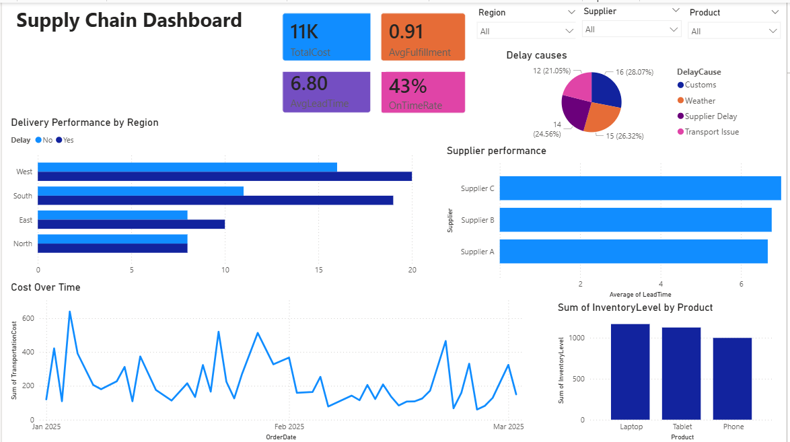

# Smart Supply Chains : Analyse avec Power BI

Projet d'analyse de la performance de la supply chain avec Power BI.

## Objectif
Le but du projet est de suivre les indicateurs principaux de la supply chain (délai de livraison, coût, taux de remplissage), de trouver les causes des retards, de comparer les fournisseurs et d'analyser l'évolution des coûts de transport.

## Problématique
L'entreprise a beaucoup de livraisons en retard, des coûts de transport qui augmentent et peu de visibilité sur la performance de ses fournisseurs. Seulement 43% des commandes sont livrées à temps.

## Données
Les données viennent d'un fichier Excel (supply_chain_dataset.xlsx) qui contient 100 commandes, de janvier à mars 2025.

Il contient : l'identifiant de la commande, le produit (Phone, Tablet, Laptop), le fournisseur (A, B, C), la région (North, South, East, West), les dates de commande et de livraison, le niveau de stock, le délai de livraison, le coût de transport, le taux de remplissage, le retard (oui/non) et la cause du retard.

## Indicateurs (KPIs)
- Taux de livraison à temps : 43%
- Délai moyen de livraison : 6,8 jours
- Coût total de transport : environ 11K
- Taux de remplissage moyen : 0,91

## Méthodologie
1. Import du fichier Excel dans Power BI
2. Nettoyage des données avec Power Query
3. Création des mesures avec DAX
4. Création des graphiques et des cartes KPI
5. Analyse des résultats

## Le dashboard
Le dashboard contient les 4 KPIs, un graphique des livraisons à temps et en retard par région, un graphique des causes de retard, la comparaison des fournisseurs selon le délai moyen, l'évolution du coût de transport dans le temps et le stock par produit. Il y a aussi des filtres par région, fournisseur et produit.

## Résultats
- La région West a le plus de retards (20), puis South (19).
- Les causes de retard les plus fréquentes sont la douane (16) et la météo (15).
- Le Supplier A a le délai moyen le plus court (6,7 jours), mais la différence avec les autres est petite.
- Les coûts de transport changent beaucoup d'une date à l'autre.

## Recommandations
- Mieux planifier la logistique dans les régions avec beaucoup de retards
- Choisir les fournisseurs selon leur performance
- Réduire les retards et les coûts de transport
- Utiliser le dashboard pour suivre les résultats régulièrement

## Fichiers
- Projet_Warteni_Emna_G6B.pbix : le projet Power BI(dashboard)
- Rapport_Warteni_Emna_G6B.docx : le rapport
- supply_chain_dataset.xlsx : les données
